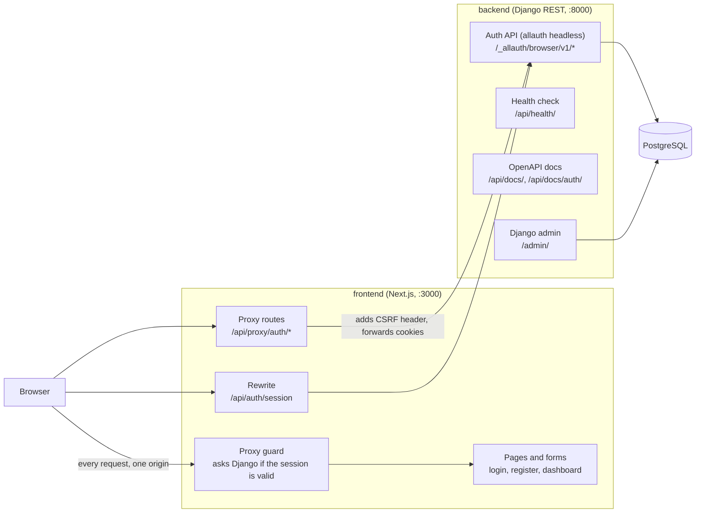

# dj-next

A full-stack authentication starter: a **Django REST** API that owns users and sessions, and a **Next.js** app that provides the sign-up, login and protected-page UI on top of it.

The two apps live in one repository and run as separate processes. The browser only ever talks to the Next.js origin; Next.js talks to Django.

## Quick start

You need [uv](https://docs.astral.sh/uv/), Node.js 20.9+ with [pnpm](https://pnpm.io/) 10, Docker and `make` (see [Prerequisites](#prerequisites)).

```bash
git clone <repository-url> dj-next
cd dj-next
make setup   # install both apps, create backend/backend/.env with a generated SECRET_KEY
make dev     # start Postgres, migrate, seed a demo user, run the API and the web app
```

Then open <http://localhost:3000> and sign in with the demo account:

| Email | Password |
|---|---|
| `demo@example.com` | `DemoPass123!` |

New accounts must confirm their email address. In development every email the app sends lands in the Mailpit inbox at <http://localhost:8025> (started by `make dev`), so you can open the confirmation link there. The demo account is already confirmed.

The API is at <http://localhost:8000>, with interactive docs at <http://localhost:8000/api/docs/> and for the authentication endpoints at <http://localhost:8000/api/docs/auth/>. Run `make help` to list every command.

## Troubleshooting

**`password authentication failed for user ...` when running `make dev`.** Another PostgreSQL on your machine (often one on port 5432) is answering instead of the Docker container. This usually means `backend/backend/.env` was created for an older setup: `make setup` never overwrites an existing `.env`. Replace it and recreate the database:

```bash
mv backend/backend/.env backend/backend/.env.old
make setup
make reset-db    # the old database volume has the old credentials
make dev
```

The template uses `127.0.0.1` and port 5433 on purpose: `localhost` can resolve to IPv6 first and reach a different server than the container.

## Overview

The project covers the part of an application that almost every product needs first: letting people register, sign in, stay signed in, and reach pages that only signed-in users can see. It uses **cookie-based sessions with CSRF protection**. No token is issued to the browser.

It is an early-stage foundation, not a finished product. There are no domain features beyond authentication (see [Project status](#project-status)).

## Technology stack

| Area | Technology | Role |
|---|---|---|
| Backend | Django 6.1, Django REST Framework | API and user model |
| Backend | django-allauth (headless API) | Registration, email verification, login, logout, sessions, password reset, two-factor authentication (TOTP), rate limiting; social login is available but not enabled |
| Backend | drf-spectacular | OpenAPI schema, Swagger UI and ReDoc |
| Backend | PostgreSQL 17 (Docker Compose) | Database |
| Backend | Mailpit (Docker Compose, development only) | Local inbox that catches verification and reset emails |
| Backend | uv, [rav](https://pypi.org/project/rav/) | Dependencies and project task runner |
| Backend | pytest, Ruff, mypy | Tests, linting/formatting, strict type checking |
| Frontend | Next.js 16 (App Router), React 19, TypeScript | UI, routing, server-side proxy routes |
| Frontend | Tailwind CSS 4, shadcn/ui (Radix) | Styling and components |
| Frontend | TanStack Form, Zod | Form handling and validation |
| Frontend | pnpm, ESLint, Prettier | Dependencies and code quality |
| Frontend | Playwright | Browser end-to-end tests |

## Features

Implemented:

- Email-based registration, login and logout.
- Mandatory email verification: a new account cannot sign in until the emailed link is confirmed. Registering an address that already exists gives the same response as a new one, so addresses cannot be probed.
- Forgot-password flow: request a reset link, then choose a new password (reset links are single-use).
- Session cookie authentication with CSRF protection (`HttpOnly`, `SameSite=Lax` cookies; `Secure` outside development).
- No API tokens for the web app: login and signup answer with the user and set cookies only. Mobile apps get a session token through the separate `app` client (see [Mobile apps](#mobile-apps)).
- Optional two-factor authentication with an authenticator app (TOTP). Set it up on `/account/security` with a QR code; ten single-use recovery codes are created, and changing these settings after a few minutes asks for the password again. Signing in then asks for the code (or a recovery code) after the password.
- Built-in rate limiting from allauth: login, signup and password reset are limited per client IP, and repeated failed logins lock an email address for a few minutes. The UI shows a clear message when a limit is hit.
- Custom `User` model with a UUID primary key and email as the login field.
- Next.js proxy routes (`/api/proxy/auth/*`) that forward auth requests to Django, adding the CSRF header from the `HttpOnly` cookie and passing every cookie back to the browser.
- Route protection in the Next.js proxy (`src/proxy.ts`): `/dashboard` requires a session that Django confirms is valid (a `sessionid` cookie alone is not trusted, because it also exists while a sign-up awaits verification), and signed-in users are redirected away from `/login` and `/register`.
- Client-side auth context that loads the current user from `/api/auth/session`, which Next.js rewrites to Django (same origin, no CORS).
- Form validation with Zod, including password strength rules on registration.
- Health check endpoint, OpenAPI schema, Swagger UI and ReDoc.
- Django admin for the custom user model.
- `seed_demo` management command that creates a demo user (refuses to run unless `DEBUG=True`).

Present in the code but not usable yet:

- Social login: the Google and Facebook buttons are placeholders that show an alert.
- Password change and email management endpoints come with django-allauth's headless API and are exposed, but the frontend has no pages for them.
- A `UserProfile` model (avatar, bio) exists but is not exposed through the API.

## Architecture



How a login works:

1. The browser submits the login form to `/api/proxy/auth/login` on the Next.js server.
2. The proxy route calls `POST /_allauth/browser/v1/auth/login` on Django, copying the `csrftoken` cookie into the `X-CSRFToken` header (client code cannot read it because it is `HttpOnly`; if the browser has none yet, the proxy fetches one first) and forwarding the `Origin` and `X-Forwarded-For` headers.
3. Django authenticates the user and replies with `sessionid` and `csrftoken` cookies, which the proxy route passes on to the browser.
4. The proxy guard asks Django whether the session is valid and then allows access to `/dashboard`. The client then calls `/api/auth/session` (rewritten to Django) to load the user for the navigation bar. That endpoint answers `401` while nobody is signed in.

## Mobile apps

The same backend serves native clients such as an Expo app. django-allauth's headless API has two client types under `/_allauth/`:

- `browser`: session cookie plus CSRF. The Next.js app uses this one.
- `app`: no cookies and no CSRF. `POST /_allauth/app/v1/auth/login` returns a `session_token`, which the app stores securely and sends as the `X-Session-Token` header; `DELETE .../auth/session` revokes it. DRF views accept that header too (`XSessionTokenAuthentication` is enabled).

This flow is covered by the backend tests. No mobile client exists in this repository yet, and it has not been tried from a real Expo build. Social sign-in from native SDKs would use allauth's provider-token endpoint, which is not configured here.

## Project structure

```text
.
├── Makefile                  One-command setup and development (make help)
├── docker-compose.yml        Local PostgreSQL and Mailpit (dev inbox)
├── backend/                  Django project (uv)
│   ├── backend/              Django source root (manage.py)
│   │   ├── config/           Settings, root URLs, ASGI/WSGI
│   │   ├── accounts/         Custom User model, admin, services, auth API tests
│   │   ├── api/              URL routing, health check, CSRF endpoint
│   │   ├── core/             wait_for_db and seed_demo management commands
│   │   └── .env.example      Environment template
│   ├── pyproject.toml        Dependencies and Ruff/mypy/pytest configuration
│   └── rav.yaml              Backend task definitions (dev server, lint, test)
├── frontend/                 Next.js app (pnpm)
│   ├── src/app/              Routes: (auth) login/register, (private) dashboard,
│   │                         (public) about, api/proxy/auth/* route handlers
│   ├── src/components/       UI primitives, form components, nav bar, auth buttons
│   ├── src/context/          Auth context (current user)
│   ├── src/lib/              Shared server-side proxy helper
│   ├── src/proxy.ts          Redirects based on a validated session
│   ├── src/app/account/      Email confirmation, password reset, two-factor sign-in and security settings pages
│   ├── e2e/                  Playwright end-to-end tests
│   ├── AGENTS.md             Notes for AI coding tools (generated by next dev)
│   └── .env.example          Environment template
└── .github/                  CI workflows (frontend, backend) and Dependabot
```

## Prerequisites

- [uv](https://docs.astral.sh/uv/getting-started/installation/). It installs the pinned Python (3.13, see `backend/.python-version`; 3.12 or newer is required) for you.
- Node.js 20.9 or newer (22 recommended, see `frontend/.nvmrc`) and [pnpm](https://pnpm.io/) 10. With Node installed, `corepack enable` provides the pnpm version pinned in `package.json`.
- Docker with Compose, for the local PostgreSQL and the Mailpit inbox. Any other PostgreSQL works if you point the `POSTGRES_*` variables at it.
- `make` (preinstalled on macOS and most Linux distributions; on Windows use WSL).

## Getting started

### One command

`make setup` and `make dev` (see [Quick start](#quick-start)). `make dev` runs the database, migrations, the demo-user seed, the API and the web app together; stop it with `Ctrl-C`, and `make down` stops the database container (data is kept).

### Step by step

```bash
make setup      # dependencies and backend/backend/.env
make db         # PostgreSQL on localhost:5433 (waits until healthy)
make migrate
make seed       # optional: demo@example.com
make backend    # API on :8000, in one terminal
make frontend   # web app on :3000, in another
```

### Without make

```bash
# Backend
cd backend
uv sync
cp backend/.env.example backend/.env       # then set SECRET_KEY
docker compose --env-file backend/.env -f ../docker-compose.yml up -d --wait db mailpit
uv run python backend/manage.py migrate
uv run python backend/manage.py runserver

# Frontend (second terminal)
cd frontend
pnpm install
pnpm dev
```

The frontend needs no `.env.local` for local development: it defaults to the API at `http://localhost:8000`.

## Environment variables

**Backend**: `backend/backend/.env` (created by `make setup`; see [`.env.example`](backend/backend/.env.example))

| Variable | Description |
|---|---|
| `SECRET_KEY` | Django secret key. Required. `make setup` generates one. |
| `DEBUG` | `True` for local development. Defaults to `False`. |
| `ALLOWED_HOSTS` | Comma-separated host names. |
| `POSTGRES_DB`, `POSTGRES_USER`, `POSTGRES_PASSWORD` | Database credentials. Required. Also used by `docker-compose.yml`. |
| `POSTGRES_HOST`, `POSTGRES_PORT` | Database address. Required. The example uses port 5433 to avoid clashing with a PostgreSQL already on 5432. |
| `EMAIL_HOST`, `EMAIL_PORT`, `EMAIL_HOST_USER`, `EMAIL_HOST_PASSWORD`, `EMAIL_USE_TLS`, `DEFAULT_FROM_EMAIL` | Outgoing email. Defaults send to Mailpit on `127.0.0.1:1025`; set these to a real SMTP provider in production. |
| `SITE_NAME` | Name used in emails. Defaults to `dj-next`. |
| `FRONTEND_URL` | Where the frontend is served from. Used for links in verification and reset emails and as the default CSRF trusted origin. Defaults to `http://localhost:3000`. |
| `CSRF_TRUSTED_ORIGINS` | Extra origins allowed by Django's CSRF check (comma-separated). |
| `DISABLE_RATE_LIMITS` | Development only: set to `True` to turn allauth's rate limits off (ignored unless `DEBUG=True`). Playwright sets it for the servers it starts. |
| `TRUSTED_PROXY_COUNT` | Number of reverse proxies in front of Django (the Next.js server counts as one), so rate limits use the real client IP. Defaults to 0. |
| `SESSION_COOKIE_SECURE`, `CSRF_COOKIE_SECURE`, `SECURE_SSL_REDIRECT` | Default to on when `DEBUG` is off. |
| `SECURE_HSTS_SECONDS` | Defaults to 3600 when `DEBUG` is off. Raise it once HTTPS works. |
| `USE_X_FORWARDED_PROTO` | Set to `True` behind a TLS-terminating reverse proxy. |
| `ADMIN_URL` | Admin path. Defaults to `admin/`. |
| `DB_WAIT_RETRIES`, `DB_WAIT_DELAY` | Optional tuning for `wait_for_db` (defaults: 30 retries, 2 seconds). |

**Frontend**: `frontend/.env.local` (optional; see [`.env.example`](frontend/.env.example))

| Variable | Description |
|---|---|
| `BACKEND_URL` | Base URL of the Django API. Server-side only; defaults to `http://localhost:8000`. The rewrite in `next.config.ts` is resolved at build time, so rebuild after changing it. |

## Available commands

**From the repository root:**

| Command | What it does |
|---|---|
| `make setup` | Install both apps and create the backend `.env` |
| `make dev` | Database, migrations, demo user, API and web app |
| `make db`, `make down`, `make reset-db` | Start, stop, or wipe and recreate the Docker services (database and Mailpit) |
| `make migrate`, `make seed` | Apply migrations, create the demo user |
| `make backend`, `make frontend` | Run one app only |
| `make test` | Backend tests (starts the database if needed) |
| `make e2e` | Browser end-to-end tests (needs Google Chrome locally) |
| `make lint` | Ruff, mypy, ESLint, Prettier and `tsc` |
| `make check` | `lint` and `test` |

**Backend** (from `backend/`, as `uv run rav run <task>`): `dev`, `migrate`, `makemigrations`, `test`, `lint`, `lint:fix`, `format`, `type-check`, `check`, `seed`, `superuser`, `health`. See [`backend/rav.yaml`](backend/rav.yaml).

**Frontend** (from `frontend/`):

| Script | What it does |
|---|---|
| `pnpm dev` | Development server |
| `pnpm build`, `pnpm start` | Production build and server |
| `pnpm lint` | ESLint |
| `pnpm type-check` | `tsc --noEmit` |
| `pnpm format` | Prettier, writing changes |

## Testing and verification

```bash
make check
```

This runs Ruff, mypy, the backend test suite (45 tests: user model, service functions, admin, browser and app authentication endpoints including CSRF enforcement, email verification, password reset, two-factor authentication with recovery codes and reauthentication, rate limiting, health endpoint, OpenAPI schema generation, management commands), ESLint, Prettier and the TypeScript compiler.

The browser end-to-end tests are separate because they start the whole stack:

```bash
make e2e
```

Eight Playwright tests drive a real browser through registration, email confirmation (reading the email from Mailpit), sign-in and sign-out, the unverified-account restrictions, a password reset, and two-factor authentication (setup, sign-in with an app code or a recovery code, wrong codes, turning it off). If you run them repeatedly against a server you started yourself, allauth's rate limits can trip; the servers Playwright starts have them switched off. Locally they use your installed Google Chrome. The frontend has no unit tests.

GitHub Actions runs both sets of checks on pushes and pull requests to `main` (`.github/workflows/`): the frontend job also builds the app, the backend job runs against a PostgreSQL service and checks for missing migrations, and a separate job runs the Playwright tests with PostgreSQL and Mailpit services. Dependabot proposes weekly updates for npm, uv, GitHub Actions and Docker Compose. The workflows have been exercised locally, but have not yet run on GitHub.

## Security notes

In place:

- Session cookies are `HttpOnly` and `SameSite=Lax`; with `DEBUG=False` they are also `Secure`, HTTPS redirect and HSTS are enabled, and `manage.py check --deploy` reports only the optional HSTS subdomain/preload settings.
- Two-factor authentication (TOTP) is available to every account, but it is optional; nothing forces users to turn it on.
- CSRF protection is enforced for authenticated writes; the CSRF cookie is `HttpOnly` and handled server-side by the Next.js proxy routes.
- No API tokens are issued, and the dashboard does not expose the session cookie.
- The browser never calls Django cross-origin, so no CORS configuration is needed.
- Dependency audits: `pnpm audit --prod` and `pip-audit` report no known vulnerabilities at the time of writing. `pnpm audit` reports one advisory in a development-only lint dependency (`braces`) for which no patched release exists yet.

Not yet in place:

- **Rate-limit configuration for production.** allauth limits login, signup and password reset per IP, but behind the Next.js server and any load balancer you must set `TRUSTED_PROXY_COUNT` so the real client IP is used, and use a shared cache (for example Redis) when running several workers. The default in-memory cache counts per process.
- Email verification is mandatory, but there is no UI yet for changing a registered email address or managing sessions.
- The Swagger and ReDoc pages (`/api/docs/`, `/api/docs/auth/`, `/api/redoc/`) are public. Restrict them in production if the API surface should not be advertised.

## Project status

Early-stage prototype. The authentication flow works end to end, but the project is a starting point rather than a production-ready application.

Known limitations:

- No frontend unit tests. The Playwright tests cover the main authentication flows only.
- Social login and a profile page are not implemented (see [Features](#features)). Two-factor authentication is only wired up for the web app; the mobile `app` client flow for it has not been tried.
- Settings are development-oriented beyond the security defaults above: console email backend (Django 6.1 deprecates `EMAIL_BACKEND` in favour of `MAILERS`, removal planned for Django 2028), no media or static file configuration, and no deployment setup.

## License

Released under the [MIT License](LICENSE).
